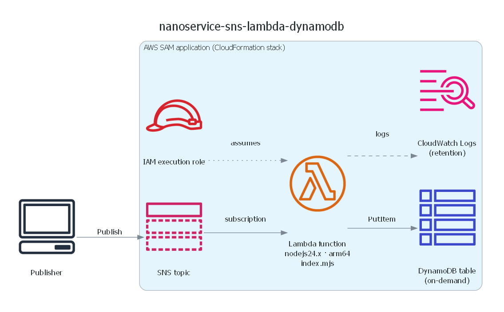

# Serverless nanoservice using SNS, Lambda, and DynamoDB



Start up:

- Deploy application, specifying table name

Test:

- Go to SNS, topics, topic (see `TopicArn` stack output), and publish message
- Go to DynamoDB, tables, table, and explore table items

Or with the AWS CLI:

```
aws sns publish --topic-arn <topic-arn> --message test
aws dynamodb scan --table-name <table>
```

Tear down:

- Go to CloudFormation and delete application stack (this also deletes the CloudWatch log group)
