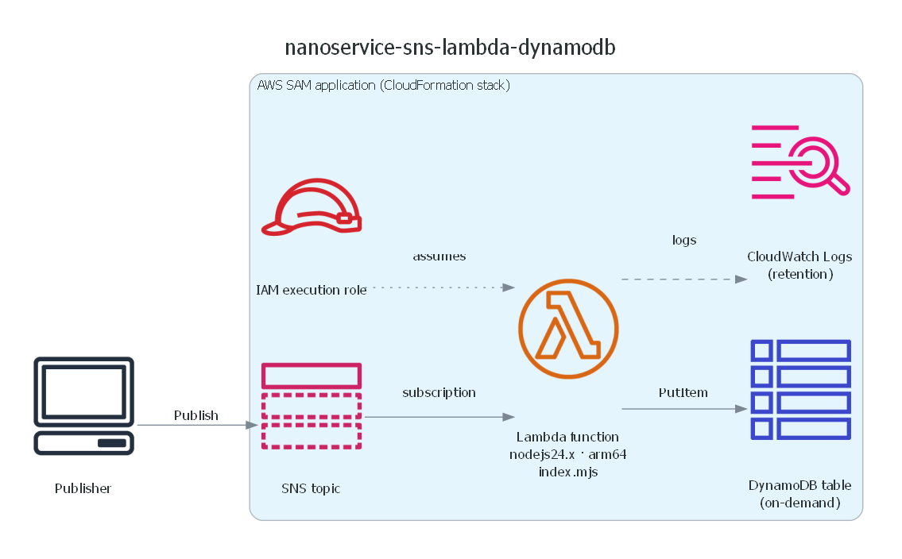

# Serverless nanoservice using SNS, Lambda, and DynamoDB

Available in the [AWS Serverless Application Repository](https://serverlessrepo.aws.amazon.com/applications/us-west-2/819097794827/nanoservice-sns-lambda-dynamodb).

## Architecture



## Prerequisites

- [AWS CLI](https://docs.aws.amazon.com/cli/latest/userguide/getting-started-install.html)
- [AWS SAM CLI](https://docs.aws.amazon.com/serverless-application-model/latest/developerguide/install-sam-cli.html)

Clone repo:
```
git clone https://github.com/bstraehle/aws-sns-lambda-dynamodb.git
cd aws-sns-lambda-dynamodb
```

Validate template:
```
sam validate --lint
```

## Deploy directly

```
sam deploy --guided --capabilities CAPABILITY_IAM --parameter-overrides TableName=<table>
```

## Publish to the AWS Serverless Application Repository

Create S3 bucket:
```
aws s3 mb s3://<bucket>
```

Update policy.json and add account and bucket info

Allow the Serverless Application Repository to read from bucket:
```
aws s3api put-bucket-policy --bucket <bucket> --policy file://policy.json
```

Package application:
```
sam package --template-file template.yaml --output-template-file packaged.yaml --s3-bucket <bucket>
```

Publish application (bump `SemanticVersion` in template.yaml for each new version):
```
sam publish --template packaged.yaml --region <region>
```

Login to the AWS Console and deploy application

## Test

- Go to SNS, topics, topic (see `TopicArn` stack output), and publish message
- Go to DynamoDB, tables, table, and explore table items

Or with the AWS CLI:

```
aws sns publish --topic-arn <topic-arn> --message test
aws dynamodb scan --table-name <table>
```

## Tear down

- Go to CloudFormation and delete application stack (this also deletes the CloudWatch log group)
- Go to S3 and empty and delete the packaging bucket, if no longer needed
